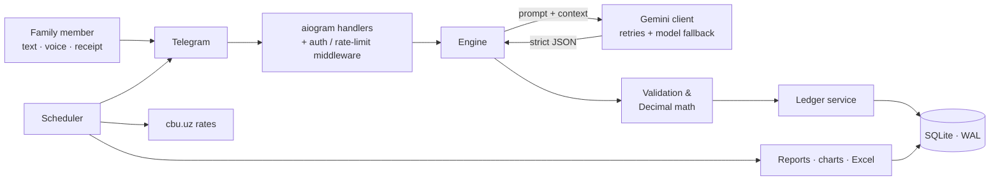

# 👛 Oila Hamyon — AI family accountant for Telegram

> *Oilaviy AI hisobchi: oddiy tilda yozing yoki ayting — bot har bir so'mni tiyinigacha hisoblab boradi.*


A Telegram bot that keeps the books for a whole family. Family members write (or **say**) what they
spent or earned in plain, messy everyday language — Uzbek Latin, Cyrillic, Russian or a mix — and the bot
turns it into a proper double-checked ledger: who paid, from which wallet, for whom, in which category
and currency.

The AI only *understands* the message. **Every number is computed by Python with `Decimal` and stored
as integer tiyin** — the language model never produces a final amount.

```
You:  non 2ta 4500dan, sut 12 ming, onamga dori 87 500
Bot:  ✅ Saved
      🛒 Bread — 9 000 so'm
           2 × 4 500 so'm
      🛒 Milk — 12 000 so'm
      💊 Medicine — 87 500 so'm · 👤 Mom
      ──────────────────
      Total spent: 108 500 so'm · Cash
      📅 Today: 108 500 so'm · October: 2 340 000 so'm
      [↩️ Undo] [✏️ Edit]
```

## ✨ Features

| | |
|---|---|
| 🗣 **Natural language input** | Latin, Cyrillic, Russian, typos and shorthand (`такси 18` → 18 000, and the bot says so) |
| 🎙 **Voice messages** | Transcribes what was said, then records it |
| 🧾 **Receipt photos / PDFs** | Reads each line, categorises it, spreads discounts across lines to the tiyin and checks the sum against the receipt total |
| 👨‍👩‍👦 **Family-aware** | "for mom", "for my brother" — resolves relatives relative to *who* is writing |
| 👛 **Multiple wallets** | Cash, cards, USD… ATM withdrawals and top-ups are transfers, not expenses |
| 💱 **Currencies** | Official Central Bank of Uzbekistan (cbu.uz) rates, cached in the DB; real exchange rate from "swapped $200 for 2 540 000" |
| ⚖️ **Balance reconciliation** | "I have 1 230 000 on my card" — compares with the ledger and books the difference |
| 🤝 **Debts & credit purchases** | Lent / borrowed, partial repayments, due-date reminders, buy-now-pay-later (expense + debt, no cash movement) |
| 🎯 **Monthly budgets** | Warnings at 80% and 100%, end-of-month forecast |
| 🔔 **Recurring payments** | "internet 120k on the 5th every month" — reminds on the day, one tap to record |
| 📈 **Price memory** | "📈 price went up: was 4 000 so'm, +12.5%" |
| ❓ **Questions** | "How much went on food this month vs last month?", "Who spent the most?" — facts computed in code, AI only phrases the answer |
| 📊 **Reports** | Any period, PNG charts (matplotlib), Excel export (openpyxl), AI "accountant's summary" |
| 🌙 **Scheduled jobs** | Evening daily summary, monthly report on the 1st, recurring/debt reminders, daily DB backup sent to admins via Telegram |
| ✏️ **Corrections by reply** | Reply to a bot message: "it was 15k", "paid by card", "delete the second one" |
| 🔐 **Private by default** | Only family members can talk to the bot; others join via a revocable invite link; per-user AI rate limit |

## 🎯 How accuracy is guaranteed

1. **The AI never computes totals.** It returns expressions such as `"2*4500"`; Python evaluates them with `Decimal`. No floats anywhere in money code.
2. All amounts are stored as **integers in tiyin** (`1 so'm = 100`).
3. Every AI response must match a strict JSON schema (Gemini structured output) and is validated again in code — unknown categories, wallets or members fall back to safe defaults.
4. **Suspicious entries are never saved silently** — the bot asks for confirmation: tiny/huge amounts, future dates, over-repaying a debt, receipt total mismatch, low model confidence.
5. Accounting rules: transfers, debts and balance adjustments are excluded from income/expense reports; a credit purchase counts as an expense once, and repaying it is not a second expense.

## 🏗 Architecture



```
hamyon/
├── __main__.py        entry point, dispatcher wiring
├── config.py          settings from .env
├── core/              money.py (Decimal ↔ tiyin), dates.py, text.py
├── db/                schema.sql, database.py (aiosqlite, WAL, atomic transactions)
├── ai/
│   ├── prompts.py     system instructions for the model
│   ├── schemas.py     strict JSON response schema
│   ├── context.py     per-request context: dates, members, wallets, debts…
│   └── client.py      Gemini client: retries, fallback models, logging
├── services/
│   ├── engine.py      message → AI → validation → accounting → save → reply
│   ├── ledger.py      general ledger: entries, balances, debts
│   ├── reports.py     period reports, daily/monthly summaries
│   ├── queries.py     facts for answering questions
│   ├── budgets.py     budgets and recurring payments
│   ├── currency.py    Central Bank exchange rates
│   ├── charts.py      PNG charts
│   ├── export.py      Excel export
│   └── family.py      families, members, wallets, categories
└── bot/               handlers, keyboards, middlewares, scheduler, texts
tests/                 money math, accounting rules, receipts, corrections, reports
tools/simulate.py      console simulator — talk to the bot's "brain" without Telegram
deploy/                systemd unit + one-shot Ubuntu setup script
```

## 🚀 Quick start

### 1. Configure

```bash
cp .env.example .env    # then fill in BOT_TOKEN and GEMINI_API_KEY
```

| Variable | Required | Default | Description |
|---|---|---|---|
| `BOT_TOKEN` | ✅ | — | Bot token from [@BotFather](https://t.me/BotFather) |
| `GEMINI_API_KEY` | ✅ | — | Key from [Google AI Studio](https://aistudio.google.com/apikey) |
| `GEMINI_MODEL` | | `gemini-3.5-flash` | Primary model |
| `GEMINI_FALLBACK_MODEL` | | `gemini-2.5-flash,gemini-flash-lite-latest` | Comma-separated fallbacks, tried in order on 429/503/timeouts |
| `DB_PATH` | | `data/hamyon.db` | SQLite file (relative to project root) |
| `TIMEZONE` | | `Asia/Tashkent` | IANA time zone |
| `OWNER_TG_ID` | | *(empty)* | Only this Telegram id may create the family; empty = first `/start` |
| `AI_RATE_PER_MINUTE` | | `12` | AI requests per user per minute |
| `LOG_LEVEL` | | `INFO` | `DEBUG` / `INFO` / `WARNING` |

### 2. Run locally

```bash
python -m venv .venv
# Windows: .venv\Scripts\activate    Linux/macOS: source .venv/bin/activate
pip install -r requirements.txt
python -m hamyon
```

Send `/start` — the first person becomes the family head (👑) and gets an invite link for the others.
The bot uses long polling, so no domain, SSL or open port is needed.

### 3. Docker

```bash
docker build -t oila-hamyon .
docker run -d --name hamyon --restart=always \
  --env-file .env -v "$(pwd)/data:/app/data" oila-hamyon
```

### 4. Linux server (systemd)

```bash
sudo bash deploy/setup.sh      # creates a system user, venv and the `hamyon` systemd service
sudo journalctl -u hamyon -f   # live logs
```

The service runs with `MemoryMax=400M`, `NoNewPrivileges` and `ProtectSystem=full`, so it fits on a free-tier VM.

## 🧪 Tests

```bash
pip install -r requirements-dev.txt
python -m pytest -q
```

Try the full AI pipeline in the console (uses a real Gemini key, separate DB):

```bash
python tools/simulate.py                      # interactive
python tools/simulate.py "non 6 ming" "/balans"
```

## 🧭 Bot menu

No commands to memorise — everything lives in a persistent reply keyboard:
📊 Report · 💼 Balance · 📒 History · 🤝 Debts · 🎯 Budgets · 🔔 Recurring payments · ↩️ Undo last ·
⚙️ Settings (daily summary time, monthly report, wallets, categories, members, invite link) · 📖 Help.

## 🔒 Security notes

- Secrets live only in `.env` (git-ignored); the setup script makes it `chmod 600`.
- The bot answers family members only; strangers can join only through an invite link, which can be regenerated.
- If a Gemini key ever leaks, revoke it in AI Studio and put a new one in `.env`.

## 📄 License

[MIT](LICENSE) © 2026 xoliddev
