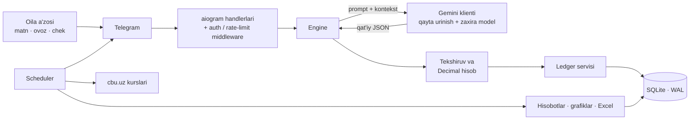

# 👛 Oila Hamyon — Telegram uchun oilaviy AI hisobchi

[English](README.md) · **O'zbekcha**

[](https://xoliddev.github.io/demos/oila-hamyon/)

> *Oilaviy AI hisobchi: oddiy tilda yozing yoki ayting — bot har bir so'mni tiyinigacha hisoblab boradi.*


[](https://github.com/xoliddev/oila-hamyon/actions/workflows/tests.yml)


Butun oilaning kirim-chiqimini yuritadigan Telegram bot. Oila a'zolari nimaga pul sarflagani yoki qancha
topganini oddiy, kundalik tilda yozadi (yoki **ovozli xabar** bilan aytadi) — lotin, kirill, rus tilida yoki
aralash. Bot esa buni puxta tekshirilgan hisob daftariga aylantiradi: kim to'ladi, qaysi hamyondan, kim uchun,
qaysi toifada va qaysi valyutada.

AI faqat xabarni *tushunadi*. **Har bir summani Python `Decimal` bilan hisoblaydi va butun son ko'rinishida,
tiyinlarda saqlaydi** — yakuniy summani til modeli hech qachon o'zi chiqarmaydi.

```
Siz:  non 2ta 4500dan, sut 12 ming, onamga dori 87 500
Bot:  ✅ Yozildi
      🛒 Non — 9 000 so'm
           2 × 4 500 so'm
      🛒 Sut — 12 000 so'm
      💊 Dori — 87 500 so'm · 👤 Ona
      ──────────────────
      Jami chiqim: 108 500 so'm · Naqd
      📅 Bugun: 108 500 so'm · Oktyabr: 2 340 000 so'm
      [↩️ Bekor qilish] [✏️ Tuzatish]
```

## ✨ Imkoniyatlar

| | |
|---|---|
| 🗣 **Oddiy tilda kiritish** | Lotin, kirill, rus tili, xatolar va qisqartmalar (`такси 18` → 18 000, bot buni aytib ham qo'yadi) |
| 🎙 **Ovozli xabarlar** | Aytilgan gapni matnga o'giradi, keyin yozib qo'yadi |
| 🧾 **Chek rasmi / PDF** | Har bir qatorni o'qiydi, toifaga ajratadi, chegirmani qatorlarga tiyinigacha taqsimlaydi va jamini chekdagi summa bilan solishtiradi |
| 👨‍👩‍👦 **Oilani taniydi** | "onam uchun", "ukam uchun" — qarindoshni *kim* yozayotganiga qarab aniqlaydi |
| 👛 **Bir nechta hamyon** | Naqd, kartalar, dollar… Bankomatdan yechish va kartani to'ldirish xarajat emas, o'tkazma hisoblanadi |
| 💱 **Valyutalar** | O'zbekiston Markaziy banki (cbu.uz) rasmiy kurslari, bazada keshlanadi; "200$ ni 2 540 000 ga almashtirdim" degan gapdan haqiqiy kursni oladi |
| ⚖️ **Qoldiqni solishtirish** | "Kartamda 1 230 000 bor" — hisob daftaridagi qoldiq bilan solishtirib, farqni yozib qo'yadi |
| 🤝 **Qarzlar va nasiya xaridlar** | Qarz berish / olish, qisman qaytarish, muddat eslatmalari, nasiyaga xarid (xarajat + qarz, pul harakatisiz) |
| 🎯 **Oylik byudjetlar** | 80% va 100% da ogohlantiradi, oy oxiriga prognoz beradi |
| 🔔 **Doimiy to'lovlar** | "har oy 5-sanada internet 120 ming" — o'sha kuni eslatadi, bir bosishda yoziladi |
| 📈 **Narxlarni eslab qoladi** | "📈 narx oshdi: avval 4 000 so'm edi, +12.5%" |
| ❓ **Savollar** | "Bu oy oziq-ovqatga o'tgan oyga nisbatan qancha ketdi?", "Kim eng ko'p sarfladi?" — faktlarni kod hisoblaydi, AI faqat javobni chiroyli qilib yozadi |
| 📊 **Hisobotlar** | Istalgan davr, PNG grafiklar (matplotlib), Excel eksport (openpyxl), AI'dan "hisobchi xulosasi" |
| 🌙 **Rejalashtirilgan ishlar** | Kechki kunlik xulosa, har oyning 1-sanasida oylik hisobot, doimiy to'lov / qarz eslatmalari, bazaning kunlik zaxira nusxasi adminlarga Telegram orqali yuboriladi |
| ✏️ **Reply orqali tuzatish** | Bot xabariga reply qiling: "15 ming edi", "karta bilan to'lagan", "ikkinchisini o'chir" |
| 🔐 **Sukut bo'yicha shaxsiy** | Bot bilan faqat oila a'zolari gaplasha oladi; boshqalar bekor qilsa bo'ladigan taklif havolasi orqali qo'shiladi; har bir foydalanuvchiga AI so'rovlari limiti |

## 🎯 Aniqlik qanday kafolatlanadi

1. **AI hech qachon jamini hisoblamaydi.** U `"2*4500"` kabi ifoda qaytaradi, Python esa uni `Decimal` bilan hisoblaydi. Pul bilan ishlaydigan kodning hech qayerida float yo'q.
2. Barcha summalar **tiyinlarda, butun son** ko'rinishida saqlanadi (`1 so'm = 100`).
3. AI'ning har bir javobi qat'iy JSON sxemaga mos kelishi shart (Gemini structured output) va kodda yana bir bor tekshiriladi — noma'lum toifa, hamyon yoki a'zo bo'lsa, xavfsiz standart qiymat olinadi.
4. **Shubhali yozuvlar hech qachon jimgina saqlanmaydi** — bot tasdiqlashni so'raydi: juda kichik / juda katta summa, kelajakdagi sana, qarzni ortig'i bilan qaytarish, chek jami mos kelmasligi, modelning ishonchi past bo'lishi.
5. Buxgalteriya qoidalari: o'tkazmalar, qarzlar va qoldiq tuzatishlari kirim/chiqim hisobotlariga kirmaydi; nasiya xarid bir marta xarajat bo'lib hisoblanadi, uni to'lash esa ikkinchi xarajat emas.

## 🏗 Arxitektura



```
hamyon/
├── __main__.py        kirish nuqtasi, dispatcher'ni yig'ish
├── config.py          .env'dan sozlamalar
├── core/              money.py (Decimal ↔ tiyin), dates.py, text.py
├── db/                schema.sql, database.py (aiosqlite, WAL, atomar tranzaksiyalar)
├── ai/
│   ├── prompts.py     model uchun tizim ko'rsatmalari
│   ├── schemas.py     javob uchun qat'iy JSON sxema
│   ├── context.py     har bir so'rov konteksti: sanalar, a'zolar, hamyonlar, qarzlar…
│   └── client.py      Gemini klienti: qayta urinishlar, zaxira modellar, loglash
├── services/
│   ├── engine.py      xabar → AI → tekshiruv → hisob-kitob → saqlash → javob
│   ├── ledger.py      bosh daftar: yozuvlar, qoldiqlar, qarzlar
│   ├── reports.py     davr hisobotlari, kunlik/oylik xulosalar
│   ├── queries.py     savollarga javob berish uchun faktlar
│   ├── budgets.py     byudjetlar va doimiy to'lovlar
│   ├── currency.py    Markaziy bank kurslari
│   ├── charts.py      PNG grafiklar
│   ├── export.py      Excel eksport
│   └── family.py      oilalar, a'zolar, hamyonlar, toifalar
└── bot/               handlerlar, klaviaturalar, middleware'lar, scheduler, matnlar
tests/                 pul hisobi, buxgalteriya qoidalari, cheklar, tuzatishlar, hisobotlar
tools/simulate.py      konsol simulyatori — botning "miyasi" bilan Telegram'siz gaplashish
deploy/                systemd unit + Ubuntu uchun bir martalik o'rnatish skripti
```

## 🚀 Tez boshlash

### 1. Sozlash

```bash
cp .env.example .env    # keyin BOT_TOKEN va GEMINI_API_KEY ni to'ldiring
```

| O'zgaruvchi | Majburiy | Standart | Tavsif |
|---|---|---|---|
| `BOT_TOKEN` | ✅ | — | [@BotFather](https://t.me/BotFather) bergan bot tokeni |
| `GEMINI_API_KEY` | ✅ | — | [Google AI Studio](https://aistudio.google.com/apikey) kaliti |
| `GEMINI_MODEL` | | `gemini-3.5-flash` | Asosiy model |
| `GEMINI_FALLBACK_MODEL` | | `gemini-2.5-flash,gemini-flash-lite-latest` | Vergul bilan ajratilgan zaxira modellar, 429/503/timeout bo'lganda shu tartibda sinab ko'riladi |
| `DB_PATH` | | `data/hamyon.db` | SQLite fayli (loyiha ildiziga nisbatan) |
| `TIMEZONE` | | `Asia/Tashkent` | IANA vaqt zonasi |
| `OWNER_TG_ID` | | *(bo'sh)* | Oilani faqat shu Telegram id yarata oladi; bo'sh bo'lsa — birinchi `/start` bosgan odam |
| `AI_RATE_PER_MINUTE` | | `12` | Har bir foydalanuvchiga daqiqasiga AI so'rovlari |
| `LOG_LEVEL` | | `INFO` | `DEBUG` / `INFO` / `WARNING` |

### 2. Lokal ishga tushirish

```bash
python -m venv .venv
# Windows: .venv\Scripts\activate    Linux/macOS: source .venv/bin/activate
pip install -r requirements.txt
python -m hamyon
```

`/start` yuboring — birinchi kirgan odam oila boshlig'i (👑) bo'ladi va qolganlar uchun taklif havolasini oladi.
Bot long polling'da ishlaydi, shuning uchun domen, SSL yoki ochiq port kerak emas.

### 3. Docker

```bash
docker build -t oila-hamyon .
docker run -d --name hamyon --restart=always \
  --env-file .env -v "$(pwd)/data:/app/data" oila-hamyon
```

### 4. Linux server (systemd)

```bash
sudo bash deploy/setup.sh      # tizim foydalanuvchisi, venv va `hamyon` systemd servisini yaratadi
sudo journalctl -u hamyon -f   # jonli loglar
```

Servis `MemoryMax=400M`, `NoNewPrivileges` va `ProtectSystem=full` bilan ishlaydi, shuning uchun bepul tarifdagi VM'ga ham sig'adi.

## 🧪 Testlar

```bash
pip install -r requirements-dev.txt
python -m pytest -q
```

To'liq AI pipeline'ni konsolda sinab ko'rish (haqiqiy Gemini kaliti ishlatiladi, baza alohida):

```bash
python tools/simulate.py                      # interaktiv
python tools/simulate.py "non 6 ming" "/balans"
```

## 🧭 Bot menyusi

Buyruqlarni yodlash shart emas — hammasi doimiy reply klaviaturada:
📊 Hisobot · 💼 Balans · 📒 Tarix · 🤝 Qarzlar · 🎯 Byudjetlar · 🔔 Doimiy to'lovlar · ↩️ Oxirgisini bekor qilish ·
⚙️ Sozlamalar (kunlik xulosa vaqti, oylik hisobot, hamyonlar, toifalar, a'zolar, taklif havolasi) · 📖 Yordam.

## 🔒 Xavfsizlik

- Maxfiy kalitlar faqat `.env` faylida turadi (git'ga tushmaydi); o'rnatish skripti unga `chmod 600` qo'yadi.
- Bot faqat oila a'zolariga javob beradi; begonalar faqat taklif havolasi orqali qo'shila oladi, havolani esa qayta yaratish mumkin.
- Agar Gemini kaliti tashqariga chiqib ketsa, uni AI Studio'da bekor qiling va `.env` ga yangisini yozing.

## 📄 Litsenziya

[MIT](LICENSE) © 2026 xoliddev
